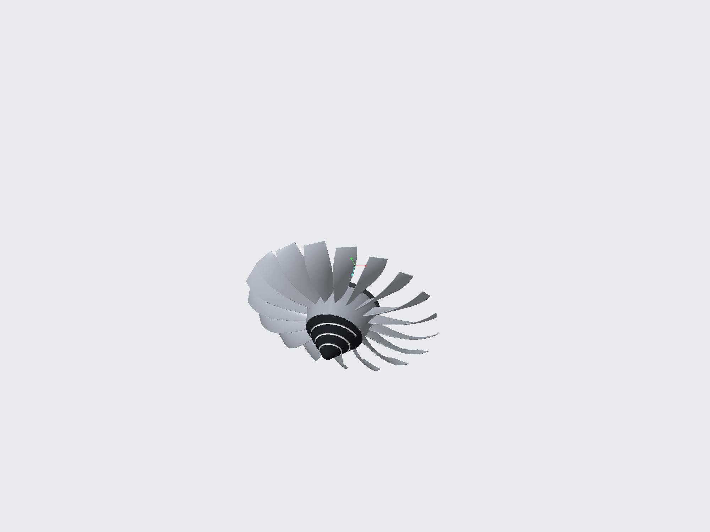
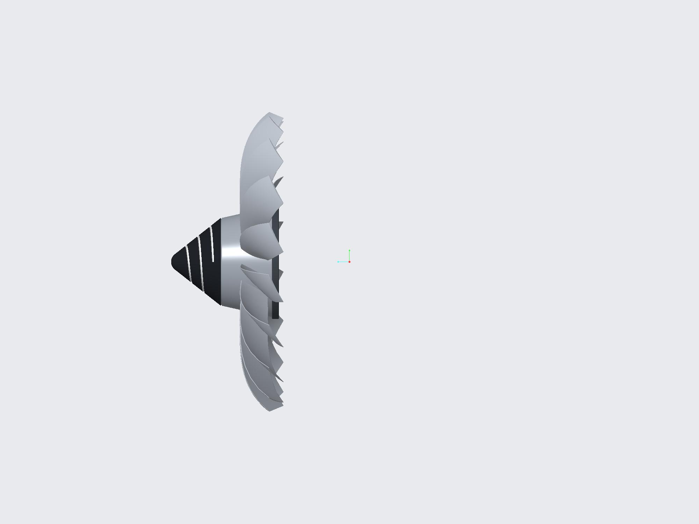

# Creo-Automation

[English](README.md) | [简体中文](README_zh.md)

**JSON-Plan-Driven C++17 Pro/TOOLKIT Parametric Modeling & Verification Engine for PTC Creo Parametric**

`Creo-Automation` compiles a lightweight synchronous Pro/TOOLKIT DLL (`creobuild.dll`) once on your machine and drives PTC Creo Parametric directly from declarative UTF-8 JSON modeling plans (`plans/*.json`) — generating native, editable Creo feature trees (`.prt` / `.asm`), `.stp` exports, model info (`.inf`), multi-view `.jpg` renders, and running isolated reopen + `PRO_REGEN_FORCE_REGEN` SHA256 verification automatically.

---

## Showcase: Turbofan Intake Fan (`plans/turbofan_intake_fan.json`)

18-blade wide-chord twisted fan built with native `revolve`, `chamfer`, `axis_pattern`, `helical_sweep`, 4-section `G1`-tangent `rotational_blend`, and automated surface coloring (`43` active features, `vol = 4576261.8840 mm³`, `area = 706874.2907 mm²`, `failed = 0`).

| Default View | Front View |
| :---: | :---: |
|  |  |

| Top View | Right View |
| :---: | :---: |
|  |  |

Preview CAD artifacts are included in [`showcase/turbofan_intake_fan/`](showcase/turbofan_intake_fan/) (`turbofan_intake_fan.prt.1`, `turbofan_intake_fan.stp`, `build_report.txt`, `verify_result.txt`).

---

## Option 1: Let Your AI Agent Auto-Deploy Everything

Using **Antigravity**, **Claude Code**, **Codex**, **Cursor**, or **Windsurf**? Just clone or send this GitHub repository URL to your AI Agent and paste:

> Clone `https://github.com/PaoMo-Run/Creo-Automation`, follow `AGENTS.md` to inspect my Windows Creo + Pro/TOOLKIT + MSVC environment (`python setup.py --check --json`), install portable MSVC if missing, and run the `plans/flanged_hub.json` smoke test to confirm everything works on my PC.

This repository ships with machine-readable diagnostics (`setup.py --check --json`), [`AGENTS.md`](AGENTS.md), [`CLAUDE.md`](CLAUDE.md), and the embedded skill [`.agents/skills/creo-parametric-automation/SKILL.md`](.agents/skills/creo-parametric-automation/SKILL.md).

---

## Option 2: One-Command Setup for Humans

### Prerequisites & Compatibility

| Component | Requirement / Status |
| :--- | :--- |
| **OS** | Windows 10 / 11 x64 |
| **Python** | 3.10+ (uses **100% standard library**, zero `pip install` needed) |
| **CAD** | **Creo Parametric 8.0** (full end-to-end verified); **Creo 9 / 10 / 11 / 12** (auto-detected, community testing welcome) |
| **Creo SDK** | **PTC Creo TOOLKIT / API Toolkits** (`Common Files\protoolkit` + `protk_unlock.exe`) + valid PTC license (`port@host` or `.dat`) |
| **C++ Compiler** | Visual Studio 2019/2022 C++ x64 Build Tools, **or** auto-installed zero-UAC Portable MSVC + WinSDK via `scripts/install_portable_msvc.py` |

> **Important Note on Pro/TOOLKIT SDK:** When installing Creo Parametric, **Creo TOOLKIT** (`API Toolkits`) is unchecked by default. If `setup.py --check` reports missing Pro/TOOLKIT headers/libs, run `<CREO_ROOT>\Parametric\bin\reconfigure.exe` and enable **Creo TOOLKIT** before building.

### Step-by-Step Quickstart

```powershell
# 1. Clone the repository
git clone https://github.com/PaoMo-Run/Creo-Automation.git
cd Creo-Automation

# 2. Run the interactive setup wizard (auto-detects Creo, license from parametric.psf, and MSVC)
.\setup.ps1
```

Or run non-interactive setup flags directly:

```powershell
# Inspect environment without making changes
python setup.py --check

# If no Visual Studio C++ compiler is installed, install zero-UAC portable MSVC + WinSDK locally:
python scripts/install_portable_msvc.py --accept-license --mirror global
# (In mainland China, use --mirror cn for Huawei Cloud NuGet mirror)

# Save detected paths and run the fast flanged_hub smoke test (14 features, ~5-15s)
python setup.py --auto --smoke-test
```

### Build & Verify Models

```powershell
# Fast regression smoke test (flanged_hub.json)
python build_cpp.py

# Build and verify the turbofan intake fan showcase
python build_cpp.py --plan plans/turbofan_intake_fan.json

# Use localized Creo default feature names (e.g., Extrude 1 / 拉伸 1) instead of custom names
python build_cpp.py --plan plans/turbofan_intake_fan.json --default-names

# Export a clean flat deliverable folder (.prt.1/.asm.1 + .jpg only)
python build_cpp.py --plan plans/turbofan_intake_fan.json --deliverable-dir output/deliverable_fan
```

*(Optional)* Install the Creo automation skill globally for your local AI agents:

```powershell
python setup.py --install-skill all   # or: antigravity | claude | codex
```

---

## Key Capabilities

- **Zero Hardcoded Environment**: `creobuild_env.py` automatically discovers Creo via CLI/env/registry/disk scan, parses `parametric.psf` for `PTC_D_LICENSE_FILE` / `LM_LICENSE_FILE` (`.dat` or `port@host`), and finds Visual Studio via `vswhere.exe` or `.tools/portable_msvc/`.
- **Human-Like, Editable Model Trees**: Builds minimal datum skeletons and single native features (`revolve`, `rotational_blend`, `helical_sweep`, `axis_pattern`, feature-scoped `set_appearance`, zero `Note_` assembly bloat) rather than uneditable meshes or dozens of discrete loft planes.
- **22 Declarative CAD & Mechanism Operations** (`src_c/creo_auto_modeler.cpp` & `src_c/creo_plan_core.hpp`):
  - **Datums & Sketches**: `datum_plane` (offset / angled), `datum_axis`, `datum_points`, 2D/3D/RZ constrained sketches with Intent Manager, `same_point`, `tangent`, `orthogonal`, `parallel`, `horizontal`, `vertical`, `ProSecdimCreate`, `spline`, `b_spline`.
  - **Solids & Patterns**: `extrude`, `revolve`, `round`, `chamfer`, `feature_group`, `axis_pattern` (feature & group patterns), `sketched_curve`, `sweep`.
  - **Advanced Native Dashboard Features**: `solid_blend`, `rotational_blend` (multi-angle internal sketches), `helical_sweep`.
  - **Surfaces, Assemblies & Drawings**: `surface_loft`, `flat_fill`, `quilt_merge`, `solidify`, `mirror`, `assemble_component` (`pin` / `slider` / `cylindrical` / `bearing` / `ball` / `planar` Mechanism joints + closed-loop `additional_sets`), `motors` (`PRO_FEAT_PM_MOTOR`), `mechanism_analysis` (`AnalysisDefinition1`), `default_view_camera`, `set_appearance`, `set_texture` (embedded bitmaps), and **GB/T A3 2D engineering drawings** (`src_c/creo_drawing_engine.hpp` -> `.drw.1`, 300-DPI monochrome `.pdf`, AutoCAD `.dwg`).
- **Dual-Phase Integrity Verification**: Every build terminates stale Creo processes, compiles & unlocks `creobuild.dll`, executes in `build_cpp/stage/`, copies deliverables into an isolated `build_cpp/verify/` sandbox (with zero external textures), runs `PRO_REGEN_FORCE_REGEN` / sheet regen, asserts `failed=0`, checks clean `trail.txt.*` (zero `!%CE` / `!%CW` / out-of-sequence), optionally persists clean model trees (`hide_auxiliary_layers` / `AUX_VERIFY_HIDDEN`) and `VERIFY_RAW_OPEN_VIEW`, and verifies `.inf` SHA256 equality or `DRW_REOPEN_VERIFIED=true`.
- **Desktop Mechanism UI & Segmented Recording Toolkit** *(optional)*: [`scripts/human_ui.py`](scripts/human_ui.py) & [`scripts/probe_creo_ui.py`](scripts/probe_creo_ui.py) provide Per-Monitor DPIv2 randomized C/S Bezier curves (~30% long-move overshoot pullback), `Ctrl+Middle` zoom (`strict_vertical`), `Shift+Middle` pan, Win11 MS Pinyin / Creo `HCS16139P`-safe input, `F2` pause/resume HUD, and lossless segmented FFmpeg MP4 screen capture.

---

## Documentation

- [`docs/PLAN_SCHEMA.md`](docs/PLAN_SCHEMA.md) — Complete JSON modeling plan syntax & reference
- [`docs/TROUBLESHOOTING.md`](docs/TROUBLESHOOTING.md) — SDK setup, unlocking, sketch solver, and trail diagnostics
- [`AGENTS.md`](AGENTS.md) / [`CLAUDE.md`](CLAUDE.md) — Autonomous agent deployment & invariants
- [`.agents/skills/creo-parametric-automation/SKILL.md`](.agents/skills/creo-parametric-automation/SKILL.md) — Distilled Pro/TOOLKIT engineering skill

---

## License & Legal Disclaimer

- This repository's original source code, scripts, JSON plans, showcase renders, and documentation are licensed under the [MIT License](LICENSE).
- `src_c/third_party/json.hpp` (`nlohmann/json`) is licensed under the MIT License (see [`src_c/third_party/LICENSE.nlohmann-json`](src_c/third_party/LICENSE.nlohmann-json)).
- **PTC Creo Parametric**, **PTC Pro/TOOLKIT**, headers, static libraries, `protk_unlock.exe`, starter templates, and license files are proprietary software owned by PTC Inc. and are **not** included in this repository. Users must provide their own legally licensed Creo Parametric and Pro/TOOLKIT installation.
