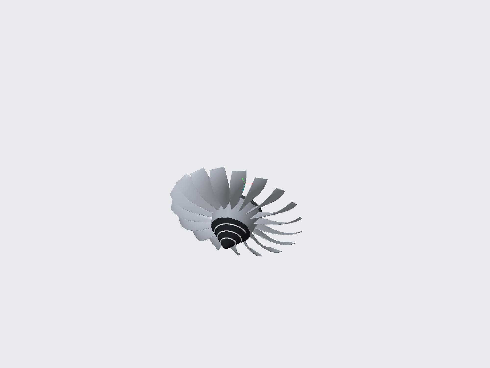
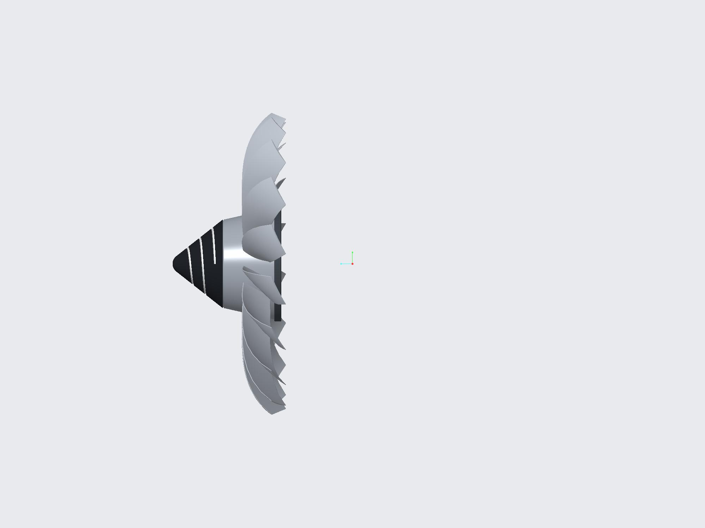

# Creo-Automation

[English](README.md) | [简体中文](README_zh.md)

**面向 PTC Creo Parametric 的 JSON 计划驱动 C++17 Pro/TOOLKIT 参数化自动建模与验证引擎**

`Creo-Automation` 只需在用户本机编译解锁一次同步 Pro/TOOLKIT DLL（`creobuild.dll`），即可通过编写声明式 UTF-8 JSON 建模计划（`plans/*.json`）直接驱动 Creo 生成可编辑的原生特征树（`.prt` / `.asm`）、`.stp` 工程文件、`.inf` 模型信息、多视角 `.jpg` 渲染图，并自动在隔离沙箱中完成独立重开强制再生（`PRO_REGEN_FORCE_REGEN`）与 `.inf` SHA256 一致性校验。

---

## 模型效果展示：涡扇发动机进气风扇 (`plans/turbofan_intake_fan.json`)

采用原生 `revolve`、`chamfer`、`axis_pattern`、`helical_sweep`、四截面 `G1` 精确相切 `rotational_blend` 宽弦扭转叶片及自动分区着色构建（`43` 项有效特征，体积 `4576261.8840 mm³`，表面积 `706874.2907 mm²`，`failed = 0`）。

| 等轴测视图 (`DEFAULT`) | 正视图 (`FRONT`) |
| :---: | :---: |
|  |  |

| 俯视图 (`TOP`) | 右视图 (`RIGHT`) |
| :---: | :---: |
|  |  |

可直接打开 [`showcase/turbofan_intake_fan/`](showcase/turbofan_intake_fan/) 查看导出的 `turbofan_intake_fan.prt.1`、`turbofan_intake_fan.stp` 与校验报告。

---

## 方式一：把 GitHub 链接发给你的 AI Agent 自动部署

如果你使用 **Antigravity**、**Claude Code**、**Codex**、**Cursor** 或 **Windsurf**，只需将仓库链接和下面这段话发给你的 Agent：

> 请克隆 `https://github.com/PaoMo-Run/Creo-Automation`，按仓库内 `AGENTS.md` 的指引检查我电脑上的 Creo + Pro/TOOLKIT + MSVC 环境（`python setup.py --check --json`），若缺少编译器则自动安装便携版 MSVC，并跑通 `plans/flanged_hub.json` 冒烟测试验证可用。

仓库内已内置机器可读诊断接口（`setup.py --check --json`）、[`AGENTS.md`](AGENTS.md)、[`CLAUDE.md`](CLAUDE.md) 以及沉淀好的工作流技能 [`.agents/skills/creo-parametric-automation/SKILL.md`](.agents/skills/creo-parametric-automation/SKILL.md)。

---

## 方式二：小白用户一键命令行向导部署

### 运行环境与兼容性

| 项目 | 要求与支持状态 |
| :--- | :--- |
| **操作系统** | Windows 10 / 11 x64 |
| **Python** | 3.10+（**纯标准库实现**，无需 `pip install` 任何第三方包） |
| **Creo 版本** | **Creo Parametric 8.0**（已实机全量验证）；**Creo 9 / 10 / 11 / 12**（支持自动探测适配，欢迎社区实机反馈） |
| **Creo SDK** | **PTC Creo TOOLKIT / API Toolkits**（`Common Files\protoolkit` + `protk_unlock.exe`）与有效许可证（`port@host` 或 `.dat`） |
| **C++ 编译器** | 本机 VS 2019/2022 C++ 工具链，或使用内置脚本**免 UAC 一键安装便携版 MSVC + WinSDK** |

> **Pro/TOOLKIT SDK 重要提示**：Creo 默认安装通常**不会勾选** `Creo TOOLKIT` 组件。如果环境检查提示缺少 Pro/TOOLKIT 头文件或静态库，请运行 `<Creo安装目录>\Parametric\bin\reconfigure.exe`，在自定义组件中勾选 **Creo TOOLKIT / API Toolkits** 后重新检查即可。

### 三步上手

```powershell
# 1. 克隆仓库
git clone https://github.com/PaoMo-Run/Creo-Automation.git
cd Creo-Automation

# 2. 启动交互式安装与环境检查向导（自动探测 Creo、parametric.psf 许可证与 MSVC）
.\setup.ps1
```

也可以直接使用命令行参数完成免交互配置：

```powershell
# 仅检查当前环境（不修改任何文件）
python setup.py --check

# 若本机没有安装 Visual Studio，免 UAC 一键下载安装绿色便携版 MSVC + WinSDK 到 .tools/portable_msvc：
python scripts/install_portable_msvc.py --accept-license --mirror cn
# （海外网络可将 --mirror cn 改为 --mirror global）

# 自动保存配置并运行 5 秒极速冒烟测试（flanged_hub.json）
python setup.py --auto --smoke-test
```

### 运行建模与验证

```powershell
# 运行默认法兰轴套冒烟/回归测试（plans/flanged_hub.json）
python build_cpp.py

# 构建并验证涡扇发动机进气风扇演示模型
python build_cpp.py --plan plans/turbofan_intake_fan.json

# 使用当前 Creo 界面语言的默认特征名（如 拉伸 1 / Extrude 1）
python build_cpp.py --plan plans/turbofan_intake_fan.json --default-names

# 另存一份仅包含 .prt.1/.asm.1 与 .jpg 预览图的干净交付目录
python build_cpp.py --plan plans/turbofan_intake_fan.json --deliverable-dir output/deliverable_fan
```

*（可选）* 将仓库内的 Creo 自动化技能同步安装到你本机的全局 Agent 技能目录：

```powershell
python setup.py --install-skill all   # 可选：antigravity | claude | codex
```

---

## 核心特性

- **零硬编码跨环境探测**：`creobuild_env.py` 自动从 CLI/环境变量/注册表/常见磁盘目录发现 Creo，从 `parametric.psf` 自动解析 `PTC_D_LICENSE_FILE` / `LM_LICENSE_FILE`（兼容 `.dat` 与 `port@host` 浮动许可），并通过 `vswhere.exe` 或便携环境定位 MSVC x64。
- **拟人化可编辑模型树**：遵循工程师手建规范——最小基准骨架 + 单一原生演化特征（`revolve`、`rotational_blend`、`helical_sweep`、`axis_pattern`、按特征作用域着色、装配体零 `Note_` 冗余），在 Creo 中可直接右键重定义草绘截面、螺距或角度，拒绝多辅助平面离散放样堆砌。
- **22 种声明式 CAD 与机构特征操作**（[`src_c/creo_auto_modeler.cpp`](src_c/creo_auto_modeler.cpp) & [`src_c/creo_plan_core.hpp`](src_c/creo_plan_core.hpp)）：
  - **基准与约束草绘**：`datum_plane`（偏移/倾角）、`datum_axis`、`datum_points`，支持 2D/3D/RZ 草绘、意图管理器约束（`same_point`、`tangent`、`orthogonal`、`parallel`、`horizontal`、`vertical`）、`ProSecdimCreate`、`spline` 与 `b_spline`。
  - **基础实体与阵列**：`extrude`、`revolve`、`round`、`chamfer`、`feature_group`、`axis_pattern`（单特征/组阵列）、`sketched_curve`、`sweep`。
  - **高阶原生交互面板特征**：`solid_blend`、`rotational_blend`（多角度内建草绘混合）、`helical_sweep`（螺旋扫描）。
  - **曲面、装配与二维国标出图**：`surface_loft`、`flat_fill`、`quilt_merge`、`solidify`、`mirror`、`assemble_component`（支持 `pin`/`slider`/`cylindrical`/`bearing`/`ball`/`planar` 运动副及闭环 `additional_sets`）、`motors`（`PRO_FEAT_PM_MOTOR`）、`mechanism_analysis`（`AnalysisDefinition1`）、`default_view_camera`（默认轴测视角固化）、`set_appearance`、`set_texture`（内嵌贴图）及 **GB/T A3 二维工程图生成**（[`src_c/creo_drawing_engine.hpp`](src_c/creo_drawing_engine.hpp) → `.drw.1`、黑白矢量 `.pdf` 与 AutoCAD `.dwg`）。
- **双阶段闭环验证门禁**：每次构建均清理残留 `xtop.exe`/`nmsd.exe`、编译并解锁 `creobuild.dll`，先在 `build_cpp/stage/` 建模/出图导出，再将产物拷入隔离 `build_cpp/verify/` 沙箱重开并执行 `PRO_REGEN_FORCE_REGEN` / 视图再生，校验 `failed=0`、`trail.txt.*` 无 `!%CE`/`!%CW`/`失序`/`out of sequence`，支持 `hide_auxiliary_layers`（`AUX_VERIFY_HIDDEN`）、`VERIFY_RAW_OPEN_VIEW`，并核对 `.inf` SHA256 一致或 `DRW_REOPEN_VERIFIED=true`。
- **桌面机构 UI 拟人化自动化与分段录屏工具链** *（可选）*：[`scripts/human_ui.py`](scripts/human_ui.py) 与 [`scripts/probe_creo_ui.py`](scripts/probe_creo_ui.py) 提供 Per-Monitor DPI 随机 C/S 弧线与长距 ~30% 过冲回拉、`Ctrl+中键` 防翻滚缩放、`Shift+中键` 平移、Win11 微软拼音 × Creo `HCS16139P` 防丢字输入、`F2` 全局暂停/恢复浮窗及 FFmpeg 无损分段 MP4 录屏。

---

## 配套文档

- [`docs/PLAN_SCHEMA.md`](docs/PLAN_SCHEMA.md) — JSON 建模计划完整语法与参数手册
- [`docs/TROUBLESHOOTING.md`](docs/TROUBLESHOOTING.md) — Pro/TOOLKIT SDK 补齐、解锁与草绘/Trail 报错排查指南
- [`AGENTS.md`](AGENTS.md) / [`CLAUDE.md`](CLAUDE.md) — 面向 AI Agent 的自动部署协议与代码不变量
- [`.agents/skills/creo-parametric-automation/SKILL.md`](.agents/skills/creo-parametric-automation/SKILL.md) — 工程沉淀核心技能文档

---

## 开源协议与免责声明

- 本项目原创代码、自动化脚本、示例 JSON 计划、演示图及文档均采用 [MIT 协议](LICENSE)开源。
- 第三方依赖 `src_c/third_party/json.hpp`（`nlohmann/json`）采用 MIT 协议（见 [`src_c/third_party/LICENSE.nlohmann-json`](src_c/third_party/LICENSE.nlohmann-json)）。
- **PTC Creo Parametric**、**PTC Pro/TOOLKIT** 头文件、静态库、`protk_unlock.exe`、模板及许可证均为 PTC Inc. 专有软件，**不随本仓库分发**，需由用户自行合法获取与安装。
